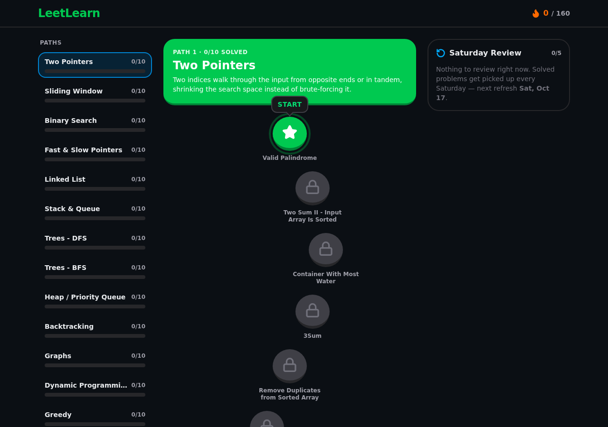
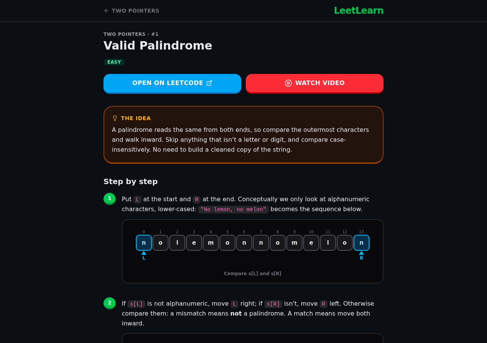
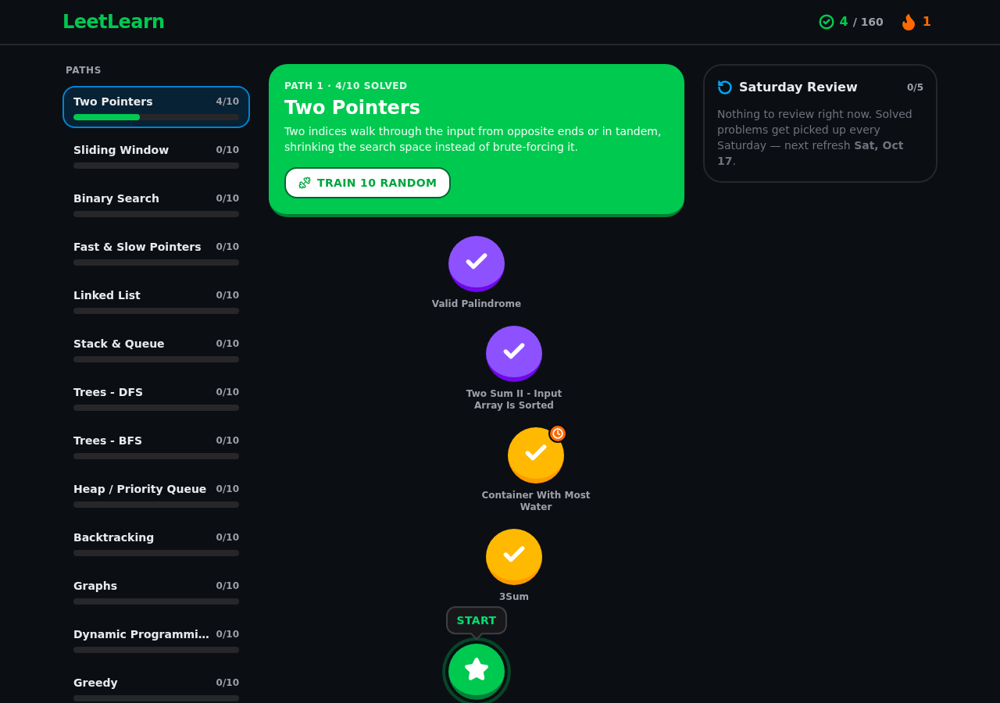
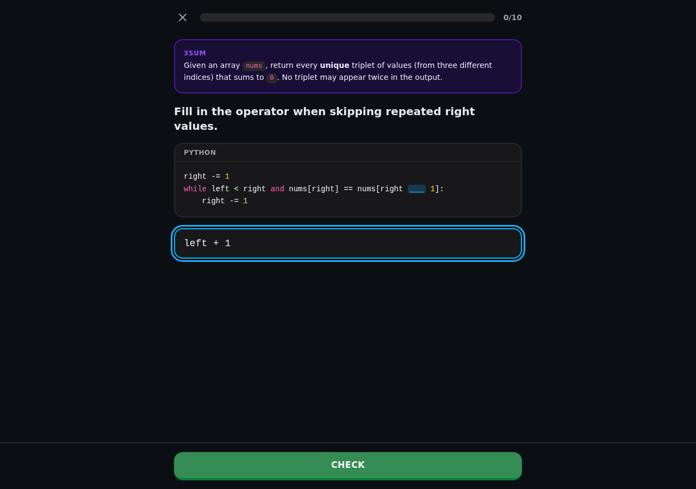
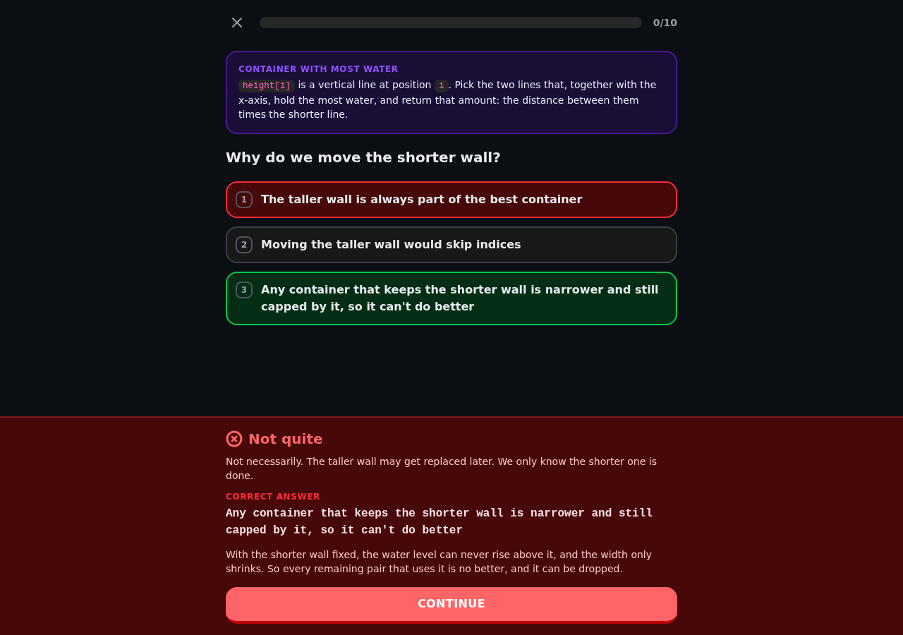

# LeetLearn

LeetLearn is a self-hosted web application built to help structure and optimize LeetCode problem-solving for technical interview preparation.

Instead of solving random problems, LeetLearn provides 16 pattern-based learning paths with a gamified, responsive UI and an automated weekly review system.





---

## Features

- 16 Learning Paths: From Two Pointers to Trie data structures.
- 160 Free Problems: Each path contains exactly 10 free LeetCode problems (2 Easy -> 7 Medium -> 1 Hard).
- Sequential Unlocking: Sequential progression per path where completing one problem unlocks the next.
- 15-Minute Benchmark: Track whether problems were completed in under 15 minutes to identify weak spots.
- Practice Timer: Optional per-problem 15-minute countdown that plays a chime when time is up. The timer resets whenever the problem modal is closed. The timer is purely a utility and never records anything about the solve.
- Solution Walkthroughs: Every problem has a dedicated page at `/solutions/<slug>` with the key idea, numbered steps illustrated by inline SVG diagrams (arrays, grids, trees, linked lists, graphs, intervals, histograms and stacks), a Python reference solution with syntax highlighting and a copy button, time and space complexity, and common pitfalls.
- Training Mode: Every problem in all 16 paths has 10 exercises that drill the reasoning behind its solution: fill-in-the-blank code, tracing a line of the solution by hand, and multiple-choice questions on the key idea and on time and space complexity. Wrong answers get feedback specific to the mistake and go to the back of the queue, so a session ends once every exercise has been answered correctly. Train a single problem from its modal, or train 10 random exercises from the solved problems of a path. Finishing a single problem's session 10/10 on the first try marks it as mastered and turns its path node violet.
- Video Links: Each problem links to a curated video walkthrough, falling back to a YouTube search for the problem.
- Installable PWA: Web app manifest, app icons and a service worker allow installing LeetLearn on desktop and mobile. Pages are network-first with a cached fallback and an offline page; static assets are cache-first.
- Daily Streak: Solving at least one problem a day (in your own time zone) grows a Duolingo-style streak shown as a flame in the header, with a 7-day calendar, longest streak and a full-screen "day streak!" celebration on the first solve of each day. Re-solving review problems counts too.
- Streak Reminders: Opt-in Web Push notifications when your streak is about to break: a nudge at a time you pick (8 PM by default) and a "last call" at 10 PM, only on days you haven't solved anything yet. Works on desktop browsers, Android and iOS/iPadOS 16.4+ (installed to the Home Screen).
- Saturday Review System: Automatically picks up to 5 previously solved problems every Saturday for spaced repetition, prioritizing problems where you struggled.
- Docker-Ready: Single-command deployment using Docker Compose.
- Single-User Mode: No authentication required, built for personal self-hosted deployment.

---

## Tech Stack

- Framework: Next.js (App Router, TypeScript)
- Styling: Tailwind CSS, Lucide React Icons
- Database: PostgreSQL, Prisma ORM
- Scheduler: node-cron integrated via Next.js instrumentation
- Notifications: Web Push (VAPID) via `web-push`
- Audio: Web Audio API (synthesized timer chime, no audio assets)
- Offline Support: Service worker and web app manifest
- Containerization: Docker Compose

---

## Quick Start

### Docker Compose Deployment

```bash
# 1. Clone the repository and enter the directory:
   git clone https://github.com/username/leetlearn.git
   cd leetlearn

# 2. Start the containers (schema sync + seeding run automatically on boot):
   docker compose up --build -d

# 3. Access the web application at http://localhost:3000.
```

Seeding is idempotent: it refreshes problem titles/URLs from `src/content/` but never resets your progress.

### Local Development

```bash
cp .env.example .env          # points at the Postgres exposed by docker compose
docker compose up -d db
npm install
npx prisma db push && npx prisma db seed
npm run dev
```

### Editing the Problem List

The 160 problems live in `src/content/patterns/*.ts` (one file per path). The corpus is validated at build and seed time: 16 paths, 10 problems each, in the order 2 Easy -> 7 Medium -> 1 Hard, with URLs matching slugs.

### Editing Solution Walkthroughs

Walkthroughs live in `src/content/solutions/*.ts`, one file per path, keyed by problem slug. The available diagram types are defined in `src/content/solutions/types.ts`, and text fields support `inline code` and **bold**. The set is validated at build time: every problem must have a walkthrough with an idea and at least one step, and every walkthrough must match a problem. Set `videoUrl` on a solution to override the default YouTube search link.

The Python code for each problem lives in `src/content/solutions/code/*.ts`, with the same file layout and slugs. It is validated the same way: every problem needs code, and every snippet must match a problem.

### Editing Training Exercises

Exercises live in `src/content/exercises/*.ts`, one file per path, keyed by problem slug, with the types in `src/content/exercises/types.ts`. There are two kinds:

- `type`: the answer is typed and compared after normalization: case, whitespace and wrapping quotes are ignored, `²` and `**` become `^`, and big-O answers match with or without `O(...)`. An optional `mistakes` list maps common wrong answers to targeted feedback.
- `choice`: multiple choice, where every wrong option carries a `why` explaining the mistake.

Set `code` to show a snippet, with `___` marking the blank, or `solution: true` to show the full reference solution. Each exercise is shown under the problem's `summary`, a one or two sentence description of the problem set in `src/content/patterns/*.ts`.

The set is validated at build time by `src/content/exercises/index.ts`: each path's file must cover all 10 of its problems, each problem needs exactly 10 exercises with at least 5 typed, complexity questions must be `choice` with `solution: true`, and every problem needs a `summary`. Each path's file is registered in `src/content/exercises/index.ts`.

### Progressive Web App

The service worker is only registered in production builds (`npm run build && npm start`, or the Docker image). To install the app, open LeetLearn in a supporting browser and use its "Install" or "Add to Home Screen" option. When offline, previously visited pages are served from the cache and other pages show `public/offline.html`.

### Upgrading an Existing Install

```bash
git pull
docker compose up -d --build
```

The container runs `prisma db push` on boot. Schema changes are additive (new tables and nullable columns only), so your progress is kept. Existing solves are used to backfill the streak history on first load.

### Streak Reminders (Push Notifications)

Open the flame in the header and tap **Turn on reminders**, then **Send test** to check delivery.

- HTTPS is required for push everywhere except `localhost`. To reach a self-hosted instance from a phone, put it behind a reverse proxy with a real certificate (Caddy, Traefik, Tailscale Serve, Cloudflare Tunnel, ...).
- iPhone/iPad (iOS 16.4+): open LeetLearn in Safari, tap Share -> **Add to Home Screen**, open it from the Home Screen icon and enable reminders there. Push is not available in a regular Safari tab.
- Reminders are sent by the server's scheduler, so the server must be running. Times follow the time zone of the device you last solved or subscribed from.
- VAPID keys are generated on first use and stored in the database. To manage them yourself, set `VAPID_PUBLIC_KEY` and `VAPID_PRIVATE_KEY` (`npx web-push generate-vapid-keys`). Changing keys invalidates existing subscriptions, so re-enable reminders afterwards. Set `VAPID_SUBJECT` to a `mailto:` or `https:` URL you own. Apple rejects `localhost` subjects.

---

## Streaks

- Each calendar day with at least one solve is stored in `ActivityDay`. The streak is the run of consecutive days ending today, or yesterday if you haven't solved anything yet today.
- The scheduler checks every 10 minutes. If the streak is still alive but nothing has been solved today, it sends the evening nudge once the reminder hour passes and the last call at 22:00, each at most once a day.

---

## Training Mode







- Training unlocks per problem once it is solved. Open a solved problem and choose **Train**, or use **Train 10 random** at the top of a path.
- `/train/<slug>` runs the 10 exercises of one problem. `/patterns/<order>/train` deals 10 exercises round-robin across the solved problems of the path, so no single problem crowds out the others.
- Exercises are shuffled on every visit. A wrong answer shows the correct answer and an explanation, then returns at the end of the queue.
- Training is practice only: it never changes solved state, the review queue or the streak. The single exception is mastery, recorded in `Problem.trainingMasteredAt` when a single problem's session is finished with all 10 exercises right on the first try. Mastery is never cleared, and mixed path sessions do not award it.

---

## Saturday Review Algorithm

The review queue refreshes every Saturday at midnight UTC and holds up to 5 problems:
1. Unsolved problems remaining in the review queue are retained.
2. Empty slots are filled with previously solved problems from any pattern without duplicates.
3. Priority Criteria:
   1. Problems NOT solved in under 15 minutes (solvedUnder15Min = false).
   2. Problems with the oldest completion timestamp (lastSolvedAt).
